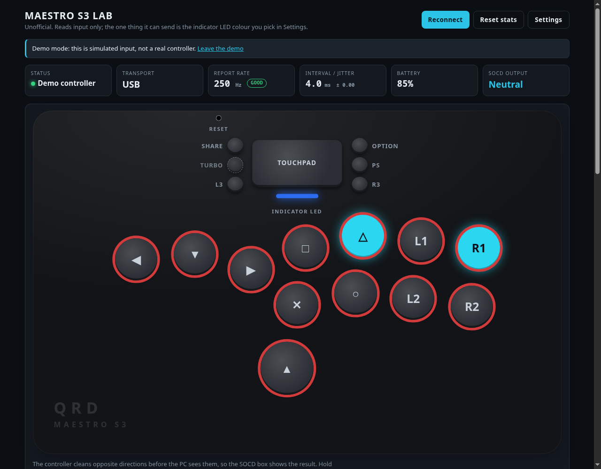

# qrd-maestro-s3-ui

A browser dashboard and a Linux toolkit for the **QRD Maestro S3** leverless controller.
It is an unofficial project: QRD did not make or endorse it.

Nothing here flashes firmware or changes the controller's saved settings. The dashboard reads
the controller's input. The only thing it can send is the standard indicator-LED command that
games send too, over USB, when you click **Send to controller**. The tools in `re/` only ask the
controller to report; they never change what it stores.



## Try the dashboard

```
git clone https://github.com/onepushmain/qrd-maestro-s3-ui
cd qrd-maestro-s3-ui
python3 -m http.server 8777 --bind 127.0.0.1     # on Windows: python -m http.server 8777 --bind 127.0.0.1
```

`--bind 127.0.0.1` keeps the server to your own computer; without it Python serves this whole folder to your network.
Open <http://localhost:8777>. There is no controller in the way: <http://localhost:8777/?demo>
plays a simulated one (`?demo=slow` simulates a slow report stream). To use a real controller,
click **Connect controller** and pick **Wireless Controller**; after the first time it reconnects by itself.

What it shows:

- the controller drawn from the diagram in QRD's manual, each button lighting as you press it
- **SOCD output**: what the controller sends after its own SOCD cleaning, so you can check which mode you are in
- **report rate and jitter**, graded GOOD, OK or SLOW, with advice when it is slow
- **switch health**: per-button press counts and double-fires (bounces), to spot a worn hot-swap switch
- **battery**, **transport** (USB or Bluetooth), and the **controller shortcuts** from the manual in one place
- **Settings**: colours, backlight rings, button names (PlayStation, arcade, Xbox or QRD's 1P to 4K), panels, the bounce window and the indicator LED

### What you need, and what it cannot do

- A Chromium-based browser (Chrome, Edge, Brave, Helium) opened from `http://localhost` or an `https` address. Firefox and Safari have no WebHID.
- Only Linux has been tested. WebHID works the same way on Windows and macOS, so it should too.
  On Windows, close other programs that hold the controller (Steam, a game), or the browser cannot open it.
- The controller must be in its default **D-input** mode, where it appears as a DualShock 4 (USB id `054C:09CC`).
  In **X-Input** mode (Option + Share for 3 s) it is not visible to the page. Only DualShock 4 class controllers are offered;
  other gamepads, such as a PS5 DualSense, use a different report layout and are not supported.
- Over Bluetooth the dashboard reads the buttons but cannot set the LED.
- On Linux, if the browser cannot open the device, install the udev rules below.
- The dashboard sees what the controller sends, not what you hold. Where the controller cancels two directions, the page cannot know you pressed them.

## Findings

Details, with how each was measured, are in [`re/FINDINGS.md`](re/FINDINGS.md).

- **The default latency mode is slow.** On the unit this was built with, it sent one report every
  16 ms (62 Hz), about a game frame. In its fastest latency mode (**Option + 4K**) it sent one every
  4 ms (247 Hz). The setting is saved on the controller. Check yours with `sudo tools/measure-latency.sh 5`
  or with the dashboard's report rate.
- It presents itself as a DualShock 4 v2. The firmware build string it reports (June 2017) is a DualShock 4
  string, not necessarily its own build date.
- We found no sign of the SOCD, turbo, macro, remap or LED settings in the controller's feature reports,
  and QRD ships no configuration app. `re/snapshot.py` lets you test any one setting yourself;
  we have not run it for every setting.
- **A warning about QRD's V1.05 firmware updater.** The download we fetched on 2026-10-20 contained
  indicators matching the XRed worm. Static analysis only, nothing was run; hashes and how to check
  are in [`re/FIRMWARE-NOTES.md`](re/FIRMWARE-NOTES.md). Do not run it before checking.

## Linux tools

| Path | What it does | Needs |
|------|--------------|-------|
| `tools/install-udev.sh` | Installs udev rules for your controller: stable names `/dev/input/qrd-maestro-s3` and `/dev/qrd-maestro-s3-hidraw`, browser and LED access, and hides the unused motion and touchpad nodes from desktop input stacks | sudo. `--print` previews, `--remove` undoes, `--uinput` adds what the filter needs |
| `tools/measure-latency.sh` | The real report rate over USB, from usbmon. `--analyze FILE` reads a saved capture | sudo to capture |
| `tools/debounce.py` | Chatter filter: swallows button and direction double-fires and re-publishes a clean virtual pad. Runs on your computer; the controller is untouched | python-evdev, uinput access |
| `tools/lightbar.sh` | Sets the indicator LED through the kernel; `battery` colours it by charge | the udev rules, or sudo |
| `tools/sdl-mapping.sh` | Prints an SDL2 game controller mapping line (`dist/maestro-s3-sdl.txt` is its output) | none |
| `re/identify.py` | Prints the controller's Bluetooth MAC, the host it is paired with, and its firmware build string | none |
| `re/dump_features.py` | Lists every HID feature report the controller declares and what it answers | none |
| `re/snapshot.py` | Save every feature report, change one setting on the controller, save again, diff | none |

The controller looks like a real DualShock 4 to the system, so the udev rules for the input names, the LED files and the
`/dev/qrd-maestro-s3-hidraw` name are keyed to **your controller's Bluetooth MAC** and leave other controllers alone. The one
exception is read access to `/dev/hidraw*`, which the browser needs and which applies to every DualShock 4 v2: the driver
learns the MAC only after that node exists. (On a fresh plug the hidraw name can be missed for the same reason;
`sudo udevadm trigger --subsystem-match=hidraw` applies it.) `tools/install-udev.sh` finds it when one controller is connected;
otherwise pass it with `--mac AA:BB:CC:DD:EE:FF` (`python3 re/identify.py` prints it). The rules make the LED files
writable by every local user; delete that rule if you share the machine.

`tools/debounce.py` only helps programs that read evdev. Steam and most recent games use SDL's HIDAPI driver, which reads
`/dev/hidraw` directly and bypasses the filter; start those with `SDL_JOYSTICK_HIDAPI=0`.

## Controller shortcuts

From QRD's printed manual and the firmware 1.05 notes. All of these are stored on the controller.

| Combo | Function |
|-------|----------|
| Option + Up (2 s) | Cycle SOCD: SOCD1 (Up wins, left+right neutral) → SOCD2 (both neutral) → EZ. Newer firmware adds SOCD3 (last input wins) |
| Option + 4K | Latency: the fastest setting (called "lowest" in the 1.05 notes, "highest" in the manual) |
| Option + 2K / 4P | Latency: automatic / medium |
| Option + 3K or 3P | The other latency settings. The manual and the 1.05 notes disagree on which is which |
| L3 + R3 (2 s) | Button backlights: 8 colours, breathing and colour-changing patterns, off |
| Option + Left / Down / Right (2 s) | Direction buttons act as D-pad / left stick / right stick |
| Turbo + button (2 s) | Give that button turbo; hold Turbo 2 s to switch continuous / infinite |
| Option + Share (3 s) | X-Input mode, wired only |
| Home + Share, while off | Bluetooth pairing |

In PlayStation names: **1P is □, 2P is △, 3P is L1, 4P is R1, 1K is ✕, 2K is ○, 3K is L2, 4K is R2.**

## Development

`make test` runs everything: the decoding logic (`core.js`), the browser tests (headless Chromium over the DevTools
protocol, skipped if Chromium is missing) and the Python and shell tools, which run against fake sysfs trees and
never touch real hardware. `make lint` checks syntax. Tested with Node 26 and Python 3.14. The browser tests need Node 22 or
newer (for its built-in WebSocket client) and Chromium, and skip themselves without them.

| File | |
|------|---|
| `core.js` | Report decoding, button table and layout, settings validation, counters. No DOM, fully tested |
| `app.js` | The page's wiring |
| `demo.js` | The simulated controller behind `?demo` |
| `re/`, `tools/`, `dist/` | The Linux toolkit and its udev rule templates |
| `tests/` | Tests and two fixtures captured from a real controller |

## License

MIT
